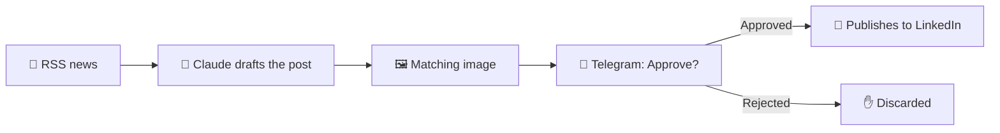

<!-- GitHub profile README. Save as README.md in the public repo named exactly like your GitHub username. -->

# Hey, I'm Samuel Medina 👋

**I build software, automate businesses with AI, and ship practical tools that save people hours.**

Tech Lead & Full-Stack Engineer · 15+ years · PHP/Laravel & Go · n8n & LLM automation · Cloud/DevOps

 

---

## 🆕 Latest: an AI content pipeline with a human in the loop

**Real industry news in, professional LinkedIn posts out — and nothing goes live until I tap _Approve_.**

An **n8n** workflow that pulls news from RSS feeds, drafts a post with **Claude** in a calm, professional tone, finds a matching image, and sends the draft to me on **Telegram**. Only if I approve it does it publish to LinkedIn. What used to take hours now takes minutes.

<!--
  Add your screenshots to an /assets folder in this repo, then keep these lines.
  Before uploading, rename the nodes (e.g. "RSS news", "Draft with Claude", "Approve on Telegram", "Publish to LinkedIn")
  and make sure no credentials, API keys or private URLs are visible.
-->

  
    
  

---

## 🚀 What I do

| 🤖 AI automation | 🛠️ Software development | ☁️ Cloud & DevOps |
|---|---|---|
| Workflows with **n8n** and LLMs | Backend in **PHP (Laravel)**, **Go**, **Node.js** | Deployments on **AWS** and **Google Cloud** |
| WhatsApp support and answers | Front-end with **React** and **Vue** | **Docker** and **Kubernetes** |
| Orders, reports and posts on autopilot | E-commerce: **PrestaShop**, **WordPress** | **CI/CD** pipelines (Jenkins) |

---

## 🧠 Featured work: AI in real operations

I led a team of **9 engineers** that designed an automation system combining **computer vision, IoT and machine learning** (TensorFlow, ESP32, Go, Python, PHP) to control vehicle entry and exit at distribution centers.

**Result:** manual verification time reduced by **more than 60%**.

Since then I've led teams on large web platforms and e-commerce projects, set up cloud infrastructure and CI pipelines, and mentored developers through agile delivery.

---

## 🧰 Stack

 

 

---

## 🤝 Work with me

Is your business losing hours to repetitive work like answering the same WhatsApp questions, copying orders by hand or building weekly reports? It can probably be automated.

- 🔍 I review your processes and tell you **what to automate first**
- ⚡ I build AI workflows tailored to how your business actually runs
- 🧑‍💼 Always with a human review step where it matters

📩 Message me on [Instagram](https://instagram.com/smdg.ia.innovation) or [email](mailto:samuelmedinadg@gmail.com).

---

<b>🇲🇽 Resumen en español</b>

 

Ingeniero de software con más de 15 años de experiencia. Automatizo tareas repetitivas de negocios con inteligencia artificial (WhatsApp, pedidos, reportes y publicaciones), siempre con revisión humana donde importa. También desarrollo con PHP/Laravel, Go, React y Vue, y trabajo con AWS, Google Cloud, Docker y Kubernetes.

Escríbeme por [Instagram](https://instagram.com/smdg.ia.innovation) o por [correo](mailto:samuelmedinadg@gmail.com).

Always building. Always automating.

